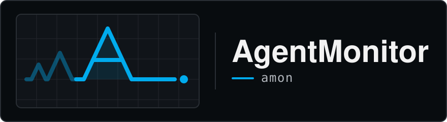

<p align="center">
  
</p>

# AgentMonitor

A local dashboard for the AI coding agents you run. AgentMonitor reads the session
history that Claude Code and Codex already keep on your machine. You can see what
your agents are doing now, search what they did before, and follow token usage and
estimated cost across projects. It runs entirely on your computer, and its
command-line tool is called `amon`.

It's for developers who use Claude Code or Codex daily, often in several projects
at once, and want one place to look. It's built for single-user local use.

## What it does

- **Monitor** shows active sessions as cards with their recent events, cost for
  today and the last 30 days, context-window use, and remaining plan quota where the
  provider reports it.
- **Sessions** lets you browse and full-text search past conversations, including
  tool calls and subagents, and pin moments you want to find again.
- **Analytics** charts activity, projects, tools, token usage and cost by model and
  project, alongside skill activity from your sessions.
- **The `amon` CLI** returns the same data as JSON, so an agent can look up its own
  history.
- **Optional extras:** written insights generated with your own OpenAI, Anthropic,
  or Gemini key; Claude Code hooks and Codex telemetry for live activity; benchmark
  imports; database backups; and a macOS login service.

Claude Code sessions get the most detail. Codex live activity is a summary (requests,
tools, tokens, cost), and full Codex transcripts come from its session files.
Antigravity CLI history is imported at summary level.

## Agent setup

Open your coding agent and paste this:

```text
Set up AgentMonitor for me: https://github.com/davisbuilds/agentmonitor

Read its README first. Clone it if I don't already have a checkout. Using
Node.js 24.22.1 and pnpm 11.28.6, run `pnpm install` and `pnpm build` in the
checkout. Start it with `node dist/cli.js serve --no-portless` and keep it
running. On the first start it reads my existing history before it answers. On a
large history that can take several minutes, so while startup is still running,
wait and retry `node dist/cli.js status` rather than restarting it. If the process
exits, report its error. Once status reports it reachable, give me the link
http://127.0.0.1:3141/app/. Then use `node dist/cli.js sessions list --agent claude`
and `--agent codex` to tell me which of my agents' history it found.

Ask me before anything that changes my system or my agents' settings:
installing Claude Code hooks, editing my Codex config, linking `amon` globally,
installing the login service, or using the HTTPS address (it installs a local
certificate and may ask for my password). Don't set up insights or any API keys
unless I ask.
```

Your agent handles the install and first check, and asks before anything that
changes your agents or your system. Prefer the terminal? Follow the
[quick start](#quick-start).

## Quick start

You need macOS or Linux, Git, [Node.js](https://nodejs.org/) 24.22.1 (pinned in
`.nvmrc`, so `nvm use` selects it), and [pnpm](https://pnpm.io/installation)
11.28.6. AgentMonitor runs with no Claude Code or Codex history, but then it has
nothing to show.

```bash
git clone https://github.com/davisbuilds/agentmonitor.git
cd agentmonitor
pnpm install
pnpm build
node dist/cli.js serve --no-portless
```

Then open <http://127.0.0.1:3141/app/>. Press Ctrl-C in that terminal to stop it.

### What success looks like

The terminal prints:

```text
AgentMonitor listening on http://127.0.0.1:3141
Dashboard: http://localhost:3141/app/
```

AgentMonitor then reads your existing history: Claude Code first, then Codex, then
Antigravity. **The server can't answer until all three are read.** The page may sit
loading, and `node dist/cli.js status` may report the server as unavailable. On a
large history this can take several minutes. Leave it running rather than
restarting it, because a restart begins the reading again.

Startup is complete when the page responds. If you have history, **Sessions**
should list conversations from each agent you use; use the Agent filter to check
each one. From a second terminal in the same folder:

```bash
node dist/cli.js status                        # Server: reachable
node dist/cli.js sessions list --agent claude  # repeat with --agent codex
```

On the first start, about five seconds after the server begins answering,
AgentMonitor also reads your history for token usage and cost. On a large history
the server can pause again while it does. **Analytics → Usage** shows tokens and
estimated cost by model and project once that finishes. **Monitor** fills in while
your agents run. After that, AgentMonitor picks up sessions as their files change,
and rescans every few minutes for anything it missed.

To follow progress in the terminal, `[watcher] Initial sync complete: …` covers
Claude Code only. Codex and Antigravity each print their own `[watcher] Codex sync: …`
or `[watcher] Antigravity sync: …` line when they find history. A
`[watcher] Watching … for changes` line means all three are done.

For a first session, finish a short Claude Code or Codex conversation in one of
your projects: ask "Summarize this project and suggest a small next step."
Return to **Sessions**, open that conversation, and try searching for
"small next step". This also gives a new installation with no history something
to show.

### Optional: the named HTTPS address

Without `--no-portless`, `node dist/cli.js serve` also serves the app at
<https://agentmonitor.localhost> through [Portless](https://github.com/vercel-labs/portless),
which comes with AgentMonitor. On its first run, Portless creates a local
certificate authority, adds it to your system's trusted certificates, and listens
on port 443. That can prompt for your password. Hooks and Codex telemetry keep
using `http://127.0.0.1:3141` either way.

## Connect your agents

History shows up without changing your agents. To see activity as it happens,
start AgentMonitor first, then:

- **Claude Code:** preview the hook install, then run it and confirm when asked.
  It adds hooks to `~/.claude/settings.json`. Restart Claude Code afterwards.

  ```bash
  node dist/cli.js hooks install claude --dry-run
  node dist/cli.js hooks install claude
  ```

  The hooks post events only to your local AgentMonitor. One of them also blocks a
  few obviously destructive `rm` commands as a best-effort check. It isn't a
  security control, and `AGENTMONITOR_SAFETY=0` turns it off. See the
  [Claude Code hook guide](hooks/claude-code/README.md) for details and the
  statusline bridge that adds Claude plan quota to Monitor.

- **Codex:** print the telemetry settings and add them to `~/.codex/config.toml`,
  then restart your Codex sessions. The block includes `log_user_prompt = true`,
  which sends prompt text to your local AgentMonitor. See the
  [Codex guide](hooks/codex/README.md).

  ```bash
  node dist/cli.js hooks print-codex-config
  ```

Both commands use the address of the server AgentMonitor would start with your
current settings. Run them in the same environment as `serve`.

## Everyday use

- **Keep it running (macOS).** `node dist/cli.js service install` starts AgentMonitor
  at login and restarts it after a crash. Use `service status`, `service restart`,
  and `service uninstall` with the same prefix. The service serves
  <http://127.0.0.1:3141/app/>. It records the `AGENTMONITOR_*` settings set when
  you install it, but deliberately leaves out API keys, so insights aren't available
  under it. Rerun the install after changing a setting.
- **Update.** Run `git pull`, `pnpm install`, and `pnpm build`, then restart the
  server: press Ctrl-C and start it again, or run `node dist/cli.js service restart`.
  Until you restart, the app shows **Restart needed**.
- **Let agents query it.** Finite read commands accept `--json`:

  ```bash
  node dist/cli.js sessions search "rate limit" --json
  node dist/cli.js usage summary --json
  node dist/cli.js monitor stats --json
  node dist/cli.js --help          # everything else
  ```

- **Back up.** This writes a checked copy while the server keeps running. The
  destination folder must be private to you:

  ```bash
  mkdir -p -m 700 ~/agentmonitor-backups
  node dist/cli.js database backup --output ~/agentmonitor-backups/agentmonitor.db
  ```

## Your data and privacy

- **Where it's kept.** Everything goes into one SQLite database, by default
  `data/agentmonitor.db` inside the checkout. This file is ignored by Git. Set
  `AGENTMONITOR_DB_PATH` to keep it elsewhere.
- **What it reads.** It reads Claude Code history under `~/.claude/projects`,
  Codex history under `~/.codex/sessions`, and Antigravity CLI history in
  `~/.gemini/antigravity-cli`. To change roots, set `AGENTMONITOR_CLAUDE_DIR` to
  the directory containing `projects/`, or `CODEX_HOME` to the one containing
  `sessions/`. It
  copies conversation text, tool calls, and token counts into the database so you
  can search them, and never changes the original files. Images inside
  conversations are recorded only by fingerprint and size.
- **Leaving things out.** `AGENTMONITOR_SYNC_EXCLUDE_PATTERNS` takes comma-separated
  glob patterns that skip matching folders or files, for example
  `*client-project*`. Claude Code names each project folder after its path, so a
  pattern can match a project by name. In the live stream, setting
  `AGENTMONITOR_LIVE_CAPTURE_PROMPTS`, `…_REASONING`, or `…_TOOL_ARGUMENTS` to
  `false` replaces that content with a redaction marker. These settings don't
  change what Sessions imports from history files.
- **Network.** By default the server listens on `127.0.0.1`, and refuses changes requested
  by web pages from other sites.
- **What can leave your machine:**
  - **Insights**, only if you set a provider key and generate one. AgentMonitor
    sends that provider the chosen period's activity and usage summaries. These
    include project, model, and tool names, plus selected top-session titles and
    opening prompts.
  - **Codex quota.** If the Codex CLI is installed, AgentMonitor runs
    `codex app-server` about once a minute to read your remaining plan quota. Codex
    makes that request with its own sign-in.
  - **Warehouse export**, only when you run `amon warehouse publish` with a
    Postgres address. It sends content-free session summaries.

## Configuration

AgentMonitor works without any settings. Settings are environment variables. It
does **not** read a `.env` file by itself. Either export variables in your shell, or
copy the example file and pass it to Node:

```bash
cp .env.example .env    # then edit
node --env-file=.env dist/cli.js serve --no-portless
```

Variables already set in your shell take priority over the file. The ones people
change most:

| Setting | Purpose |
| --- | --- |
| `AGENTMONITOR_DB_PATH` | Database file location |
| `AGENTMONITOR_PORT` | Server port (default `3141`; hooks and Codex need the same one) |
| `AGENTMONITOR_CLAUDE_DIR`, `CODEX_HOME` | Roots containing Claude's `projects/` and Codex's `sessions/` |
| `AGENTMONITOR_SYNC_EXCLUDE_PATTERNS` | History to skip |
| `AGENTMONITOR_TIMEZONE` | The time zone days are counted in (default: this computer's) |
| `AGENTMONITOR_INSIGHTS_PROVIDER` | `openai` (default), `anthropic`, or `gemini`, with that provider's key in `OPENAI_API_KEY`, `ANTHROPIC_API_KEY`, or `GEMINI_API_KEY` |

The Insights view appears under Analytics once a key is set.
[Operations](docs/system/OPERATIONS.md#common-configuration) groups the rest, and
[`src/config.ts`](src/config.ts) is the complete list.

## Troubleshooting

| What you see | What to do |
| --- | --- |
| `Database is already owned by AgentMonitor runtime PID …` | Another AgentMonitor (often the login service) is already using this database. Check `node dist/cli.js service status` and use or stop that one. Don't delete the lock file while that process runs. |
| Port 3141 is in use | Start with `--port <n>`. Then rerun the hook install and update your Codex config with `AGENTMONITOR_PORT` set to the same port. |
| Right after starting, the page won't load or `status` says unavailable | If the process is still running and scanning history, wait for `[watcher] Watching … for changes` or retry `status` every minute. Restarting repeats the scan. If the process exited, check its terminal error. |
| Sessions is empty | Finish a first agent conversation, then run `node dist/cli.js sync sessions --source all --dry-run`. If you have history but no files are found, check `AGENTMONITOR_CLAUDE_DIR`, `CODEX_HOME`, and your exclude patterns. |
| The app shows **Restart needed** | The build changed since the server started. Restart it. |
| The app names **unpriced models** | Cost totals leave those models out until their prices are available. Once an update includes their prices, rebuilding and restarting fills in the missing costs. |
| Codex live activity stopped updating | Make sure `~/.codex/config.toml` points at `127.0.0.1:3141` (or your port), then restart Codex sessions. |
| No Insights view | Set a provider key (see [Configuration](#configuration)) and restart. Under the login service, keys aren't passed through. |
| Claude quota shows as unavailable | Install the [statusline bridge](hooks/claude-code/README.md#claude-statusline-quota-bridge). |
| `pnpm install` fails building `better-sqlite3` | Switch to Node.js 24.22.1 (`nvm use`) and install again. |
| Certificate warning or password prompt | That's Portless setting up the HTTPS address. Run with `--no-portless`, or check its state with `pnpm exec portless doctor`. |

Deeper recovery procedures, such as rebuilding session history or repairing
imported costs, are in [Operations](docs/system/OPERATIONS.md).

## Documentation

- [Features](docs/system/FEATURES.md): what each view shows and the limits of its data.
- [Operations](docs/system/OPERATIONS.md): setup options, the login service, imports, backups, and recovery.
- [Architecture](docs/system/ARCHITECTURE.md): how data flows and which part owns what.
- [API docs](docs/api/README.md): the event-ingest contract and read APIs.
- [Vision](docs/project/VISION.md), [Roadmap](docs/project/ROADMAP.md), and [Backlog](docs/project/BACKLOG.md): direction and open work.
- [Full docs index](docs/README.md).

## Work on AgentMonitor

Focused fixes and documentation improvements are welcome. Start with
[Contributing](CONTRIBUTING.md), [development setup](docs/system/OPERATIONS.md#source-development),
and the [required checks](AGENTS.md#testing). [Architecture](docs/system/ARCHITECTURE.md#source-layout)
maps the code. Optional CLI linking and service setup live in
[Operations](docs/system/OPERATIONS.md#built-product).

## License

[MIT](LICENSE). Third-party material retains its own notices and license terms.
